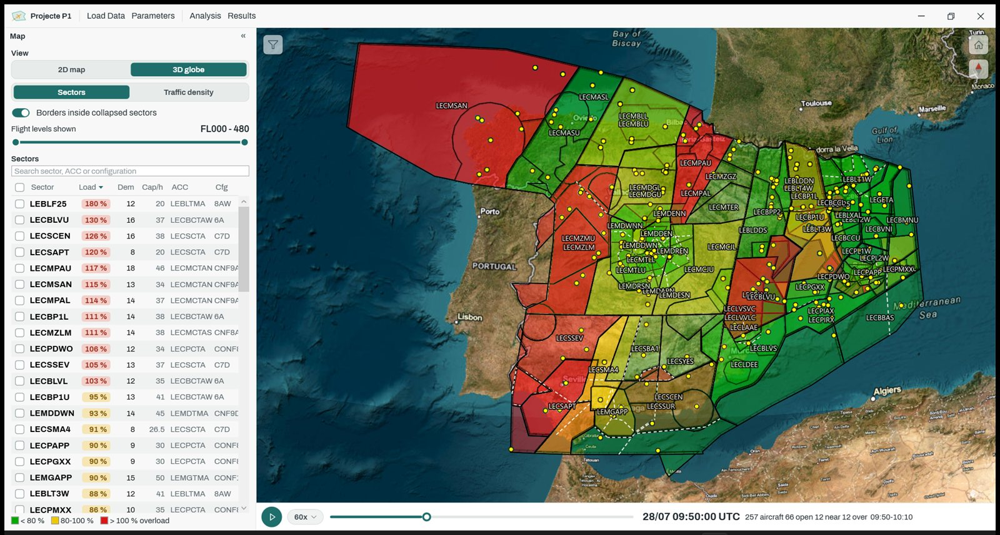
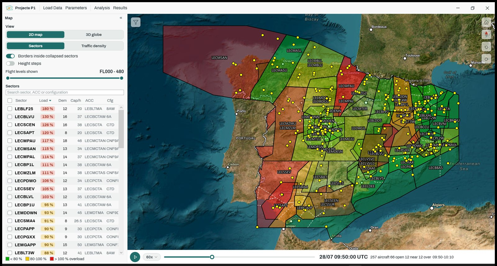
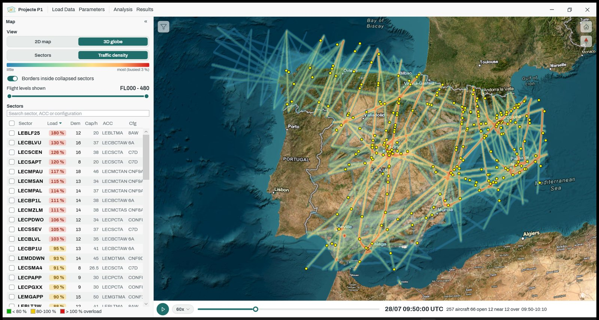
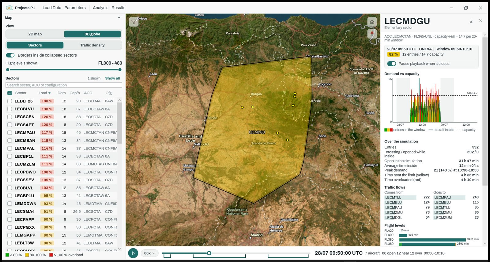
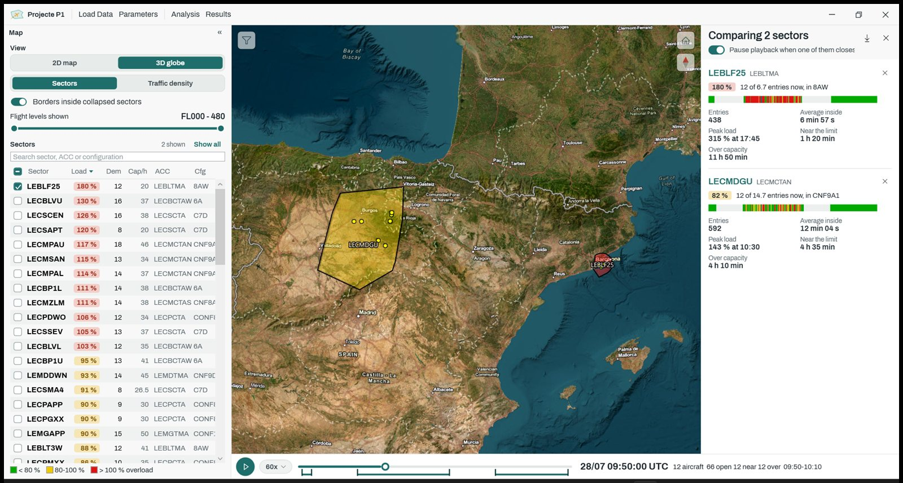
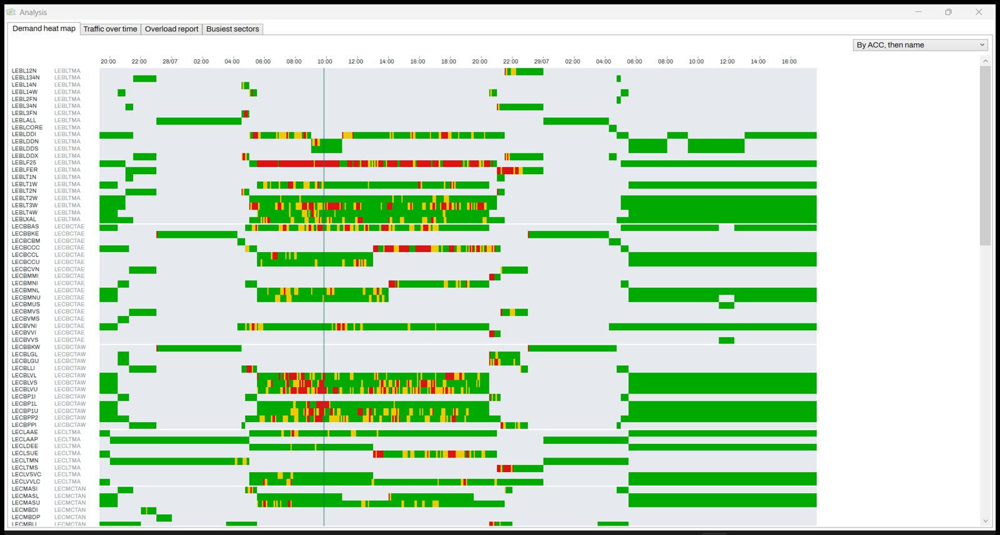

# Projecte P1: Trajectory Entries and Sector Demand

PGTA Project 1. A Windows desktop app (WPF, .NET 8) that reads EUROCONTROL-style airspace and traffic files (AIRAC 1608, July 2016), works out when every flight enters and leaves each open ATC sector, counts the demand per sector against its capacity, and shows it all over time on an ArcGIS map in 2D or 3D.

Workflow: load the files, compute the entries, calculate the demand, compare it with the capacity, watch it over time.



## Install (recommended)

1. Download **ProjecteP1-setup.exe** from the [Releases page](https://github.com/PGTA-P1/Projecte/releases/latest).
2. Run it. The setup is not signed, so Windows may show "Windows protected your PC": click **More info > Run anyway**.
3. Start **Projecte P1** from the Start menu.

It installs for your user only (no administrator rights), includes everything it needs (.NET and the map key) and can be removed from Windows Settings > Apps. It needs Windows 10 or 11 (64-bit) and an internet connection for the map imagery.

The app opens with an empty globe. Choose **Load Data > Default data (Archives folder)**; about 10 seconds later the sectors, the timeline and the menus appear.

## Building from source

Needs the [.NET 8 SDK](https://dotnet.microsoft.com/download/dotnet/8.0), or Visual Studio 2022 with the ".NET desktop development" workload. The first build downloads the NuGet packages (ArcGIS Maps SDK 300.1.0, NetTopologySuite 2.6.0).

```bash
git clone https://github.com/PGTA-P1/Projecte.git
cd Projecte
dotnet run --project "Projecte1(WPF)/Projecte1(WPF).csproj"
```

Or open `Projecte 1.sln` in Visual Studio and press F5.

**Map key.** The ArcGIS licence string and API key (both free) are in the repository, scrambled in `Projecte1(WPF)/arcgis.keys.dat`, so a clone works as it is. To use other keys, write them in `Projecte1(WPF)/arcgis.keys.json` as `{ "License": "...", "ApiKey": "..." }` (Git ignores this file and the app prefers it), then run `installer/scramble-keys.ps1` to update the `.dat`.

**Installer.** `installer/build-installer.ps1` publishes the app with .NET included and builds `installer/output/ProjecteP1-setup.exe` with [Inno Setup 6](https://jrsoftware.org/isinfo.php) (`winget install JRSoftware.InnoSetup`).

## Using the app

| What | How |
|---|---|
| Play / pause | Play button or **Space**; speed 1x to 1800x on the pill next to it |
| Go to a time | Drag or click the time bar |
| 2D map or 3D globe | Switch at the top of the left strip |
| Sectors or traffic density | Second switch in the strip |
| Flight levels shown | Two-handle slider in the strip (display only: entries and demand always use every level) |
| One sector in detail | Double-click it on the map or in the list: panel with its demand chart, flows, levels and an Excel export |
| Compare sectors | Tick two or more in the list |
| Show everything again | **Show all**, **Esc**, or the home button on the map |
| Charts and reports | **Analysis** (heat map, traffic over time, overload report, busiest sectors) |
| Exports | **Results** menu |
| Entry and demand parameters | **Parameters** |
| Full screen | **F11** |

Colours: green below 80 % of capacity, yellow 80 to 100 %, red above (overload). Load = entries in the current window divided by the capacity per window.

### Views

| 2D map | Traffic density |
|---|---|
|  |  |

| One sector | Comparing sectors |
|---|---|
|  |  |

**Analysis** window, demand heat map: one row per sector, one column per sliding step, coloured like the map (grey = closed). The other tabs show the traffic over time, every overload and the busiest sectors.



## Parameters

| Parameter | Default | Meaning |
|---|---|---|
| Minimum time in sector | 30 s | Shorter stays are not counted as entries |
| Reentry time | 60 s | A gap at least this long between two stays makes a new entry |
| Integration window | 20 min | Entries are counted in windows of this length |
| Sliding step | 5 min | How often a new window starts |

Capacity per window = hourly capacity × window / 60. Changing the window or step applies at once; changing the two times recomputes the entries.

## Data files

The default set is in `Projecte1(WPF)/Archives/` and is copied next to the program when it is built. **Load Data > Your own files...** loads another set: add the files one by one, as a .zip, or drop them on the window. Each one is checked as soon as it is added; a bad line is reported with the file, the line and the reason.

| File | Content |
|---|---|
| `sectors_1608.are` | Airblocks (polygons) |
| `sectors_1608.sls` | Elementary sectors: airblocks with flight-level bands |
| `Airspace_1608.spc` | Airspaces and collapsed sectors |
| `Configuration_1608.cfg` | Sectors of each ACC configuration |
| `OpeningScheme_1608.cos` | Which configuration each ACC has open, and when |
| `20160728Initial_initial.so6` | Flight trajectories (the traffic of 28/07/2016) |
| `capacity_sector_level.csv` | Hourly capacity per sector (999 = no limit) |
| `accs.txt` | The ACCs to study (the Spanish ones) |

## Exports

The first export asks for a folder (proposed: `Documents\Projecte P1 exports`); **Results > Export folder...** changes it.

- `entries.csv`: every entry (flight, sector, entry, exit, duration, ACC, configuration, cause)
- `demand.csv`, `traffic.csv`, `sectors.csv`, `overloads.csv`: the analysis views
- `sector_<NAME>.xlsx`: one sector, from its panel
- `comparison_load_<sectors>.csv` and `comparison_summary_<sectors>.csv`: from the comparison

The CSV files use `;` as separator, start with the parameters used, and keep the day and the time (UTC) in separate columns.

## Project structure

```
Projecte1(WPF)/
  ReadData/        file readers and their error messages
  Classes/         data model (airblocks, sectors, configurations, trajectories)
  NTSMethods/      sector geometry (NetTopologySuite), crossings and entries
  Simulation/      timeline, demand, analysis and exports
  ArcGisMethods/   drawing on the ArcGIS map and globe
  Archives/        default data files
  Assets/, Fonts/  app logo and the Archivo font (SIL Open Font License)
  arcgis.keys.dat  ArcGIS licence and API key, scrambled (ArcGisKeys.cs reads it)
installer/         Inno Setup script, build-installer.ps1, scramble-keys.ps1
docs/images/       the screenshots of this README
  MainWindow.xaml  main window; SectorPanel, ComparePanel, AnalysisWindow, DataFilesWindow
  mainProgram.cs   loading and entry computation
```

## Troubleshooting

- **The map stays grey or black:** no internet connection (the imagery is online), or the map key is missing or has expired (the app warns at start-up when the keys file is missing).
- **An export fails:** the file may be open in Excel; close it and export again.
